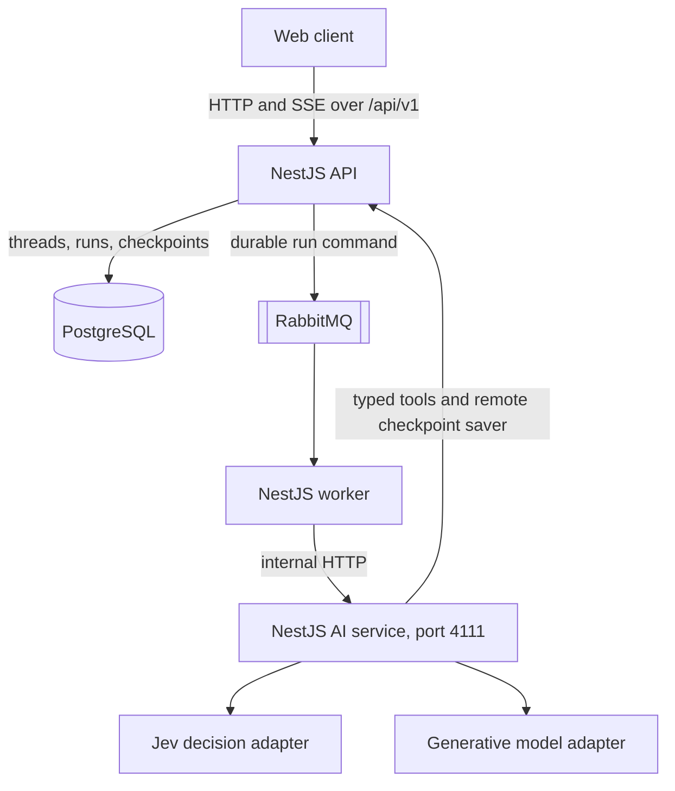
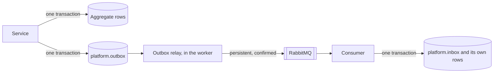
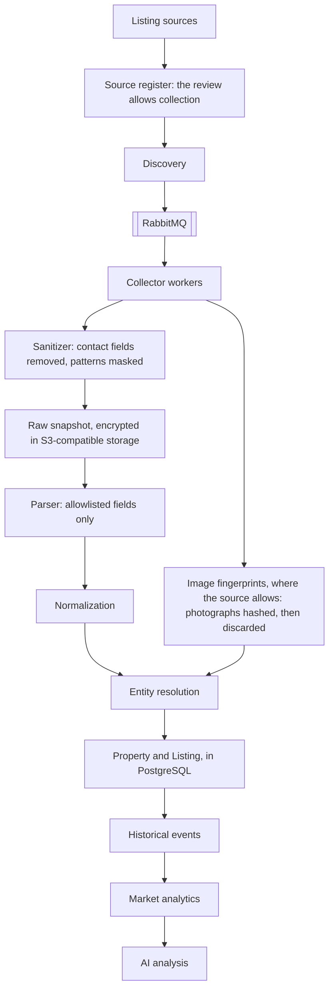
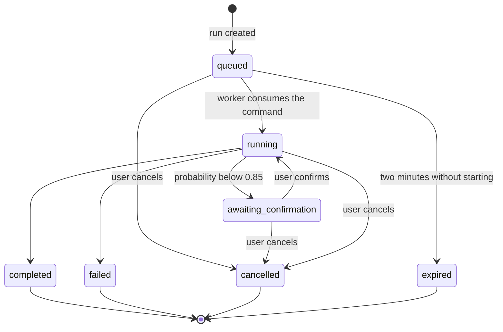

# Architecture: Real Estate Intelligence

> Companion to `spec-real-estate-intelligence.md`, derived by `bmad-spec` from the product brief,
> the AI orchestration plan and the owner's decisions. Accepted ADRs under `specs/adrs/` are
> normative: where this file and an ADR disagree, the ADR wins.

## Decision records

| ADR  | Decides                                                                                         | Binds                          |
| ---- | ----------------------------------------------------------------------------------------------- | ------------------------------ |
| 0003 | `pg` driver, no ORM, versioned SQL migrations, extensions enabled by the migration needing them | All persistence                |
| 0004 | Vitest as the single runner, hand-written doubles, when integration and e2e tests start         | All tests, CAP-17              |
| 0005 | OpenTelemetry with explicit instrumentations, preloaded bootstrap, native NestJS logger         | Every process, CAP-18          |
| 0006 | React 19, Vite 8, TypeScript 5.9 pin; no Tailwind, router or data-fetching library yet          | CAP-19, CAP-20                 |
| 0007 | NestJS 12 for API, worker and AI; LangChain and LangGraph replace Mastra; isolation boundary    | CAP-10 to CAP-18, CAP-25       |
| 0008 | Typed intent routing with Jev, heuristic fallback, 0.85 gate, taxonomy                          | CAP-11, CAP-12, CAP-17         |
| 0009 | Resilience policies for AI providers, Zero Data Retention                                       | CAP-15                         |
| 0010 | Durable runs on RabbitMQ, remote checkpoints in PostgreSQL, SSE, thread capability              | CAP-13, CAP-14, CAP-16, CAP-18 |
| 0011 | Nine bounded contexts, a context as one folder per layer package, a schema per context          | Every module                   |
| 0012 | Domain events, the transactional outbox, idempotent consumers, RabbitMQ as the only broker      | CAP-1, CAP-5, CAP-13           |
| 0013 | A port and an adapter for every external system, one resilience composition, idempotency keys   | CAP-1, CAP-2, CAP-15           |
| 0014 | Verified Zero Data Retention for every user-text model route, with fail-closed enforcement      | CAP-10, CAP-15                 |

ADR 0002 is superseded by ADR 0007. ADR 0001 sets the record itself: an accepted ADR is never
edited, only superseded.

`docs/architecture/architecture.html` draws the same architecture, diagram by diagram.

### Decisions awaiting an ADR

The owner took these decisions after the accepted ADRs; each needs its ADR before code. RabbitMQ as
the only broker left this list: ADR 0012 records it.

| Decision                                                                                                    | Relation | Affects                     |
| ----------------------------------------------------------------------------------------------------------- | -------- | --------------------------- |
| Field allowlist, image fingerprints, sanitized and encrypted raw snapshots, 30-day expiry, suppression list | New      | CAP-2, CAP-3, CAP-4, CAP-28 |
| Tile provider and PostGIS, decided with the V2 Map screen; GeoSampa fiscal blocks as its block layer        | New      | CAP-24                      |
| Keycloak as the identity provider, and how the API and the web application validate a session               | New      | CAP-32                      |

## Current state

- Foundation only: four applications (`apps/web`, `apps/api`, `apps/worker`, `apps/ai`), four
  packages (`@rei/domain`, `@rei/application`, `@rei/contracts`, `@rei/infrastructure`),
  configuration, telemetry, the PostgreSQL connection, health endpoints and the deterministic rule
  `pricePerSquareMeter` in the `market` module.
- No entities, collectors, comparables, AI tools or business endpoints exist. The other domain
  modules are empty placeholders.
- API and worker run NestJS 11 and `apps/ai` runs Mastra; ADR 0007 moves all three to NestJS 12
  and replaces Mastra with LangChain and LangGraph.
- Compose declares PostgreSQL (PostGIS image, no extension enabled), API, worker, AI and web;
  Valkey and MinIO sit under the `optional` profile and nothing consumes them. There is no broker.
- `apps/web` renders the landing page only (see `ux.md`).

## Process topology

| Process       | Owns                                                                                                                                     | Never holds                                                                 |
| ------------- | ---------------------------------------------------------------------------------------------------------------------------------------- | --------------------------------------------------------------------------- |
| `apps/web`    | Screens, the headless run client, locale formatting                                                                                      | Business rules and calculations                                             |
| `apps/api`    | Public facade: creates and reads runs, validates access, persists threads, runs and checkpoints, publishes progress over SSE             | AI provider SDKs                                                            |
| `apps/worker` | Crawling and asynchronous jobs; consumes durable commands, processes them idempotently, serializes runs per thread, calls the AI service | AI provider SDKs                                                            |
| `apps/ai`     | LangChain, LangGraph, model adapters and typed tools; model credentials and internal tokens of minimal scope                             | `DATABASE_URL`, broker or object-storage credentials, `@rei/infrastructure` |

API and worker are the only holders of broker credentials. Tools reach domain capabilities over
typed HTTP, through `/api/v1` or internal endpoints that are explicitly authorized.

### Public and protected surfaces

| Surface   | Holds                                                                                                                       | Access                                                            |
| --------- | --------------------------------------------------------------------------------------------------------------------------- | ----------------------------------------------------------------- |
| Public    | Place overview, search, property, listing, market, comparables, map, natural-language runs within quota, the privacy notice | No authentication; a thread is reached with its opaque capability |
| Protected | Operations, entity-resolution review, alert rules, followed places and properties                                           | An authenticated, authorized user                                 |

Protected operations are built behind the authorization boundary and stay unexposed until
authentication and authorization run. Nothing stands in for them meanwhile: no operator token,
configuration switch or browser-held ownership.

Authentication (CAP-32) is the first increment after the MVP, ahead of V2, and is delegated to
Keycloak, the workspace's shared identity infrastructure. Its repository,
`repos/portifolio-shared-keycloak`, holds no configuration yet. Authentication fills the
security-principal identifier the ownership model already reserves and separates two levels: a
signed-in user, for alert rules and followed items, and an operator, for Operations and review.
Operations and review open with it; alerts follow when CAP-23 is built.

## Bounded contexts and modules

The product is a modular monolith: the logical boundaries below are fixed now, and whether a
context ever gets its own deploy or database is decided later, by its own metrics (ADR 0011).

| Context       | Class      | Aggregates                                              | Responsibility                                                                |
| ------------- | ---------- | ------------------------------------------------------- | ----------------------------------------------------------------------------- |
| `properties`  | Core       | `Property`, `Listing`, `Match`                          | What exists, how it was advertised over time, which listings are one property |
| `market`      | Core       | `MarketSnapshot`, `SaleFigure`, price facts             | Deterministic place figures and their movement                                |
| `comparables` | Core       | `ComparableSet`                                         | Comparable properties selected by stated criteria (V2)                        |
| `collection`  | Supporting | `Source`, `CollectionRun`, `RawSnapshot`, `Suppression` | What may be collected, what was collected, what must stay out                 |
| `locations`   | Supporting | `Place`                                                 | Country to street block, and reference geography                              |
| `ask`         | Supporting | `Thread`, `Run`, `Checkpoint`, `Quota`                  | Natural-language runs: their record, order, pause and progress                |
| `alerts`      | Supporting | `AlertRule`, `Alert`, `FollowedItem`                    | Fixed rules evaluated after a collection run (after the MVP)                  |
| `audit`       | Generic    | `AuditEntry`                                            | Append-only record of relevant operations                                     |
| `identity`    | Generic    | `Principal`                                             | Who is acting and with which role, behind Keycloak (after the MVP)            |

- `Property` and `Listing` are distinct entities in one context; search is a query of that
  context. `market` absorbs the brief's `analytics`, `collection` its `collectors` and `snapshots`,
  `ask` its `agents`.
- A context is the same folder name in each layer package and in each application that serves it:
  `packages/domain/src/<context>/<aggregate>/`, `packages/application/src/<context>/<aggregate>/`,
  `packages/infrastructure/src/<context>/`, `packages/contracts/src/<context>/`,
  `apps/api/src/<context>/`, `apps/worker/src/<context>/`. Files are grouped by aggregate and the
  technical layer is a file suffix.
- Dependency direction: `@rei/api` and `@rei/worker` → `@rei/application` → `@rei/domain`.
  `@rei/domain` depends on no framework or SDK.
- A context is imported only through its `index.ts`: a facade, the DTOs it returns and its event
  contracts. A query across contexts is a facade call; a state change across contexts is an event.
- Each context owns one PostgreSQL schema and is its only reader and writer. No foreign key crosses
  a schema. The `platform` schema holds the outbox, the inbox and the idempotency keys.

### Context relations

| Upstream     | Downstream                  | Relation                                                                           |
| ------------ | --------------------------- | ---------------------------------------------------------------------------------- |
| `collection` | `properties`                | Customer and supplier: parsed snapshots become listing observations                |
| `locations`  | `properties`, `market`      | Open host service: places are resolved and referenced by identifier                |
| `properties` | `market`, `alerts`, `audit` | Published language: listing and property events                                    |
| `properties` | `comparables`               | Customer and supplier: candidates through the facade                               |
| `market`     | `alerts`                    | Published language: a computed snapshot                                            |
| `ask`        | AI service                  | `RunExecutor` port; the AI service calls back through typed tools and the saver    |
| `identity`   | Every protected surface     | Conformist to Keycloak behind the port; the product sees a principal and its roles |
| Every one    | External systems            | Anti-corruption layer: a port in the context, an adapter in infrastructure         |

## Ports and adapters

Every external system sits behind a port declared by the context that needs it and named for the
capability. The adapter translates the vendor model to the canonical one before anything enters
the domain, and maps failures to a closed set (ADR 0013).

| Port                           | Context      | Adapters behind it                                                                    |
| ------------------------------ | ------------ | ------------------------------------------------------------------------------------- |
| `ListingSource`                | `collection` | One per source: the synthetic dataset, an open-data file, a reviewed site or API      |
| `RawSnapshotStore`             | `collection` | S3-compatible storage: MinIO, R2                                                      |
| `TransactionSource`            | `market`     | One per source of recorded transactions; the ITBI files once their reuse is confirmed |
| `ReferenceGeography`           | `locations`  | GeoSampa fiscal blocks, loaded for the V2 map; not a `ListingSource`                  |
| `RunExecutor`                  | `ask`        | Internal HTTP to the AI service                                                       |
| `IdentityProvider`             | `identity`   | Keycloak                                                                              |
| `EventPublisher`               | `shared`     | RabbitMQ; in-memory in tests                                                          |
| `IntentDecider`                | `apps/ai`    | Jev through the gateway; the deterministic heuristic                                  |
| `LanguageModel`                | `apps/ai`    | OpenAI, Anthropic, Gemini, Ollama, any compatible API                                 |
| `CheckpointSaver`, typed tools | `apps/ai`    | Internal HTTP to the API                                                              |
| Embedding model, reranker      | `apps/ai`    | External APIs or local models, swapped without touching business rules                |

`RawSnapshotStore` is the earlier `ObjectStorage` port, renamed for what the context asks of it.
`ListingSource` fetches and parses, so a stored snapshot is parsed again without a request to the
source.

## Events and the transactional outbox

A service appends its events to `platform.outbox` in the transaction that changes the aggregate. A
relay in the worker publishes them to RabbitMQ with publisher confirms; consumers are idempotent
through `platform.inbox` (ADR 0012).

Events are named `context.aggregate.action`. Final names and payloads belong to the stories; the
catalogue below is the starting point.

| Event                                                                  | Consumed by                      | To                                                |
| ---------------------------------------------------------------------- | -------------------------------- | ------------------------------------------------- |
| `collection.snapshot.stored`                                           | `collection`                     | Parse the stored snapshot                         |
| `collection.snapshot.parsed`                                           | `properties`                     | Apply the observation to the listing              |
| `collection.run.completed`                                             | `properties`, `alerts`           | Mark unseen listings removed; evaluate the rules  |
| `collection.listing.suppressed`                                        | `properties`, `market`, `audit`  | Erase the listing, its fingerprints and its facts |
| `properties.listing.created`, `.price-changed`, `.description-changed` | `properties`, `market`, `alerts` | Resolve the entity; record price facts            |
| `properties.listing.removed`, `.reappeared`                            | `market`, `alerts`               | Close or reopen time on market                    |
| `properties.property.asking-price-changed`, `.merged`, `.split`        | `market`, `comparables`          | Recount each property once at its asking price    |
| `properties.match.queued-for-review`, `.decided`                       | `audit`                          | Record the decision and its evidence              |
| `market.snapshot.computed`                                             | `alerts`                         | Evaluate the rules on market value                |
| `ask.run.requested`                                                    | `ask`, in the worker             | Execute the run, serially within its thread       |
| `ask.run.completed`, `.failed`, `.cancelled`, `.expired`               | `audit`                          | Record the outcome                                |

The five listing events of the brief (`ListingCreated`, `ListingPriceChanged`,
`ListingDescriptionChanged`, `ListingRemoved`, `ListingReappeared`) are the history kept inside the
`Listing` aggregate; the events above are how the rest of the product hears of them. A removal
request is a `Suppression` in `collection`, committed before anything is erased, so no later run
restores the listing.

## Ingestion pipeline

- Crawling, parsing, enrichment, embeddings, deduplication, snapshot generation and trend analysis
  run in workers, with retries, idempotency, bounded concurrency, rate limiting and dead-letter
  handling where needed. Their jobs travel on RabbitMQ.
- The pair of source and identifier at the source is unique, so ingestion is idempotent (ADR 0003).
- Provenance of a value: `value`, `source`, `collectedAt`, `sourceUrl`.
- Listing events: `ListingCreated`, `ListingPriceChanged`, `ListingDescriptionChanged`,
  `ListingRemoved`, `ListingReappeared`. A removal is only `ListingRemoved`; it is never read as a
  sale.
- An entity-resolution match stores `SamePropertyProbability` and its reasons, for example similar
  coordinates, identical area, identical bedrooms, similar description, overlapping images. In the
  MVP the reasons come from rules only.
- Overlapping images compare fingerprints, never photographs. Where the review of a source allows
  fetching images, the collector fetches photographs of the listing, computes a perceptual
  fingerprint of each in memory and discards the image; those requests count against the rate
  limit of the source. The synthetic dataset has no photographs: its fixture carries the
  fingerprints.
- A property's asking price is the lowest among its active listings; place metrics count each
  property once at that price.
- Alerts are evaluated after each collection run, by fixed rules.

Match thresholds, versioned configuration recalibrated against the labelled synthetic dataset:

| Probability          | Outcome                          |
| -------------------- | -------------------------------- |
| 0.90 or more         | Merged automatically             |
| From 0.50 up to 0.90 | Kept separate, queued for review |
| Below 0.50           | Kept separate, not queued        |

### Privacy and sources

The owner, a natural person, is the controller as a small-size processing agent, on the legal basis
of legitimate interest. These rules are an engineering reading of the LGPD, not a legal opinion.

Stored from a real listing, a closed allowlist:

- property type, asking price, area, bedrooms, bathrooms, parking spaces and features;
- the location as the source publishes it, without unit or complement;
- dates, the listing source and the source URL;
- the advertiser type (private or agency) and the agency name, which belongs to a legal entity;
- the description, after phone numbers, e-mail addresses, CPF numbers and links are masked;
- image fingerprints, computed at collection from photographs that are then discarded.

Never stored: the name, phone, e-mail or individual CRECI number of a natural person, and
photographs.

Snapshots and removal:

- A raw snapshot of a real source is sanitized before it is stored (contact fields removed, the
  same patterns masked in text), encrypted at rest and deleted 30 days after collection.
  Reprocessing works inside that window; afterwards the normalized data keeps the snapshot hash.
- Snapshots of the synthetic dataset hold no personal data and are kept.
- A removal request deletes the stored data, snapshots and image fingerprints of a listing and adds
  it to a suppression list that collection consults, so a later run does not restore it.

Before the first real collection:

- a public privacy notice in Brazilian Portuguese and English, naming the controller and the
  contact e-mail, both supplied by configuration;
- the removal routine and its suppression list;
- a record of processing operations and a legitimate-interest assessment, kept in the repository;
- the source register, holding per source the access policy, the date its terms were reviewed,
  whether its images may be fetched and whether its listing text may be shown.

A source is enabled only after its terms of use, robots policy and licence were reviewed and allow
automated collection; `listing-sources.md` holds the candidates and each outcome. A collector never
works around a login wall, a CAPTCHA, a block or a rate limit. The synthetic dataset stays live as
a labelled source beside any real one.

The review of a source also settles two permissions, each a no until established:

- **Images.** Whether photographs may be fetched to compute fingerprints.
- **Listing text.** Whether the description may be shown. Where it may, the API returns the masked
  description and the comparison of its versions; where it may not, the API returns only that the
  description changed and when, and the screen links to the source. The rule covers any excerpt,
  such as the source sentence of an interpreted attribute (CAP-30). The masked text stays stored
  for parsing and entity resolution either way.

Open data that is not listing data:

- **GeoSampa** (CC BY-SA 4.0) is reference geography: its fiscal blocks become the block layer of
  the V2 map, when PostGIS arrives. It creates no `Property`, its IPTU base is not used and
  nothing of it is ingested in the MVP, where the place hierarchy comes from the address a listing
  publishes. Its data is attributed wherever it appears and in the privacy notice, and any map
  layer or file that reproduces or transforms its geometry, with the figures drawn on it, is
  published under CC BY-SA 4.0. That is the conservative reading, with no legal review.
- **ITBI transactions**, once the Secretaria Municipal da Fazenda confirms their reuse, feed only
  place figures (CAP-33): by neighborhood or street block and period, above a configured minimum
  of transactions, tagged `Sale`. A transaction is never attached to a property, and its
  unit-level fields are dropped before anything is stored, the raw snapshot included.

Written confirmation of reuse is sought first from Caixa, for its property list, and from the
Fazenda, for the ITBI transactions; each stays disabled until a written answer allows it.

### Conceptual model

Candidate entities, not a schema:

| Area        | Entities                                     |
| ----------- | -------------------------------------------- |
| Tenancy     | `Workspace`, `User`                          |
| Property    | `Property`, `PropertyFeature`, `Amenity`     |
| Listing     | `Listing`, `ListingSnapshot`, `ListingEvent` |
| Place       | `Location`, `Neighborhood`                   |
| Collection  | `Source`, `Collector`, `CollectionRun`       |
| Comparables | `ComparableSet`, `ComparableProperty`        |
| Market      | `MarketMetric`, `MarketSnapshot`             |
| Outputs     | `Analysis`, `Alert`, `AgentRun`              |

The privacy decisions add a source-register entry and a suppression entry, and the later decisions
an image fingerprint per listing and a place-level sale figure; their names are left to the
stories.

### Where a model may be used

Interpreting descriptions, normalizing features, identifying amenities, assisting entity
resolution, opportunity analysis, explanations, natural-language queries, trend queries and region
summaries. Each probabilistic use needs an evaluation; the brief names intent classification,
property classification, entity resolution, amenity extraction, opportunity analysis and
natural-language responses. An attribute a model read from text is stored with its prompt version
and its source sentence. Retrieval-augmented generation and `pgvector` stay optional: no capability
requires vector search yet.

In the MVP no model takes part in ingestion: entity resolution is rule-based and listing attributes
come from the structured fields of the source. Model-interpreted attributes (CAP-30) and
model-assisted match evidence (CAP-31) arrive in V2, each with its evaluation dataset. A merge
stays decided by the deterministic thresholds, and a model reads a description only in its stored,
masked form.

## Natural-language runs

### Run flow

1. The client sends a query to the API with an idempotency key.
2. The API stores the run as `queued` and the event `ask.run.requested` in one transaction; the
   outbox relay publishes it to RabbitMQ as the durable command.
3. The worker consumes the command, applies serial exclusion per thread and calls the AI service.
4. LangGraph restores the checkpoint, runs the decision node and chooses between clarification, a
   typed tool or an unsupported-intent response.
5. Tools query the API; no tool reaches a database or infrastructure directly.
6. The AI service sends state updates to the remote service that persists the checkpoint.
7. The API publishes progress events over SSE and persists the terminal state.
8. A redelivery reuses the idempotency key and never creates a second logical execution.

### Public run states

Transitions come from the plan's run flow, ADR 0010 and the artboards. Names and schemas are
finalized in the story specs; the distinction between waiting for the user, failure and completion
is mandatory.

### First vertical flow

`price_per_square_meter`: natural-language request, typed intent decision, extraction and
validation of price and area in code, call to the deterministic backend capability, explanation of
the returned result. Jev decides the route, the generative model may explain, and neither
recalculates the value.

| Intent                   | First increment | Outcome                                             |
| ------------------------ | --------------- | --------------------------------------------------- |
| `price_per_square_meter` | Executable      | Deterministic tool result, then a model explanation |
| `listing_search`         | Recognized      | Typed unavailable result                            |
| `property_history`       | Recognized      | Typed unavailable result                            |
| `region_statistics`      | Recognized      | Typed unavailable result                            |
| `comparables`            | Recognized      | Typed unavailable result                            |
| `unsupported`            | Recognized      | Unsupported-intent response                         |

Adding an intent to the taxonomy does not make it executable; a typed backend capability must
exist first. No outcome may rest on knowledge the model improvised.

### Typed decision

The application owns a vendor-independent decision port. Its result carries at least:

- the chosen intent and the probability of the chosen alternative;
- the identifier and version of the decider;
- a degradation flag;
- latency and cost when available;
- the reason for a fallback or failure, sanitized for observability.

Rules:

- The primary adapter calls `typesafe-ai/jev` through the native Vercel AI Gateway API with atomic
  questions and closed alternatives; the response is validated before it enters graph state.
- A missing intent, an unknown alternative or an invalid payload is an adapter failure.
- At 0.85 or above the intent may proceed. Below it the graph enters `awaiting_confirmation` and
  asks for clarification or explicit confirmation, which may authorize the proposed intent without
  another Jev call.
- When Jev is unavailable a deterministic heuristic classifies the recognizable cases and marks the
  result degraded. The degraded flag neither lowers the gate nor adds a second review rule.
- Numbers, dates, money normalization, unit validation and calculations stay in code. The state
  sent to a model is minimal, with sensitive data removed where applicable.

### Generative models

| Role      | Model                             | Route                                                                                              |
| --------- | --------------------------------- | -------------------------------------------------------------------------------------------------- |
| Primary   | Claude Haiku 5.5                  | Vercel AI Gateway with Zero Data Retention; the direct provider route only once it proves the same |
| Secondary | `deepseek/deepseek-v4-flash-0731` | Vercel AI Gateway                                                                                  |

- Selection and fallback sit behind an application port.
- Every route that receives user text requires verified Zero Data Retention. The gateway receives
  `zeroDataRetention: true`; missing support, or missing evidence that the policy was applied,
  blocks the call.
- Initial limits: 16,000 characters of user input and 1,000 generated tokens.
- Portuguese and English are accepted. BRL is the default currency with no implicit conversion.
- The model asserts only deterministic results a tool returned in that run.
- Model identifiers are versioned operational configuration: a story may change one while keeping
  the primary and secondary roles, tool capability and the privacy requirements.

### Resilience

HTTP clients for Jev and the models make a single attempt. Every repetition belongs to
`@nestjs/resilience` policies, composed from the outside in:

| Order | Policy          | Role                                                                               |
| ----- | --------------- | ---------------------------------------------------------------------------------- |
| 1     | Fallback        | Jev degrades to the heuristic; the primary model degrades to the secondary         |
| 2     | Bulkhead        | Caps simultaneous calls, protecting the worker and the providers                   |
| 3     | Circuit breaker | Counts one outcome per logical operation and rejects fast while a provider is down |
| 4     | Retry           | Transient failures only, inside the remaining deadline                             |
| 5     | Rate limiter    | Every real attempt consumes capacity                                               |
| 6     | Timeout         | Bounds each HTTP attempt and propagates cancellation                               |

Failure matrix:

| Failure                                            | Treatment                                                      |
| -------------------------------------------------- | -------------------------------------------------------------- |
| `429`, `5xx`, timeout, network                     | Transient: retried                                             |
| `400 invalid_request`                              | Not retried; not counted by the breaker as a transient failure |
| Authentication, authorization                      | No automatic retry                                             |
| Exhausted quota, when identifiable                 | Opens the circuit immediately                                  |
| Zero Data Retention violated or impossible to meet | Fails closed; no fallback to a less private route              |
| Caller cancellation                                | Propagated; never becomes a heuristic or generative answer     |

- `Retry-After` is honoured only when it fits the remaining deadline; other retries use bounded
  exponential backoff with jitter.
- Limits, windows and timings are calibrated in the stories with fake-clock tests and are never
  scattered as constants in adapters.
- Typed policy events feed OpenTelemetry and metrics for retry, timeout, bulkhead rejection,
  breaker transitions, rate limiting and fallback, without prompts, responses or credentials.

The same composition wraps every adapter that leaves a process, not only the AI providers
(ADR 0013). An adapter makes one attempt; a redelivered message is the retry of a job and is not
multiplied inside the adapter. Only idempotent operations are retried, and each write carries its
key.

| Adapter                    | Idempotency key                      | Fallback when the breaker is open                       |
| -------------------------- | ------------------------------------ | ------------------------------------------------------- |
| Listing source             | Source and identifier at the source  | Pause the run at its checkpoint; the source is degraded |
| Raw snapshot store         | Content hash, used as the object key | Fail the job for redelivery; nothing is parsed          |
| Event publisher            | Event identifier                     | The row stays pending in the outbox                     |
| Run executor               | Run identifier and step              | The run fails with a typed reason                       |
| Checkpoint saver and tools | Thread and checkpoint identifiers    | The node fails; the run fails or is redelivered         |
| Identity provider          | None: reads only                     | Last key set within its lifetime, otherwise refuse      |

A login wall, a CAPTCHA or a block by a source is never retried: it opens the circuit at once and
disables the source until its register entry is reviewed.

### Durability, checkpoints and streaming

| Concern              | Rule                                                                                                            |
| -------------------- | --------------------------------------------------------------------------------------------------------------- |
| Broker               | RabbitMQ, on a dedicated vhost of the VPS's shared instance; it also carries collection and parsing jobs        |
| Delivery             | Persistent messages, publisher confirms, explicit acknowledgements, idempotent redelivery, dead-letter handling |
| Capacity             | At most three pending runs per thread; a queued run expires after two minutes                                   |
| Ordering             | Serial within a thread, parallel across threads                                                                 |
| Source of truth      | PostgreSQL for threads, runs and checkpoints                                                                    |
| Checkpointer         | A LangGraph remote saver that calls the API; `apps/ai` never instantiates a pool                                |
| Interrupt and resume | The run pauses for confirmation and resumes on the same `thread_id`                                             |
| Retention            | 30 days, keeping the terminal state and up to eight relevant turns                                              |
| Progress             | SSE with versioned events, resumable, ending in a terminal event                                                |
| Stream source        | Rows of `ask.run_event` with a sequence number, replayed from `Last-Event-ID`; `LISTEN/NOTIFY` only wakes it up |

### Security and identity

- The public demo applies quotas before it accepts a run and does not rely on the provider's rate
  limit alone: 20 questions per visitor per calendar day in America/Sao_Paulo, plus a global daily
  cap on runs. Both numbers are configuration, and an over-quota response says when the quota
  reopens.
- In the MVP an opaque capability protects each thread; the API validates it before exposing
  history, confirmation, cancellation or SSE.
- The ownership model reserves a security-principal identifier, which the Keycloak integration of
  CAP-32 fills.
- The AI service receives only model credentials and internal tokens of minimal scope.
- Tools are allowlisted; the model creates no URL, SQL or operation name.
- The brief also asks for authentication, authorization, workspace isolation, rate limiting, input
  validation, secret management and audit logs. Protected operations wait for the first two, which
  arrive with CAP-32 right after the MVP (see Public and protected surfaces). Whether workspaces
  are isolated is an open question of the spec.

### Observability

One trace context follows the HTTP request, the AMQP publish, the consume, the run, each LangGraph
node, the Jev decision, the tool and the generative call, and checkpoint operations.

Recorded, without sensitive content:

- queue time and total run duration;
- current node and graph transitions;
- intent, confidence, confirmation decision and degradation;
- provider and model, tokens, cost and latency;
- retries, timeouts, breaker, bulkhead and fallback;
- tool calls and categorical results.

Never recorded: prompts, full responses, keys, credentials, connection strings, whole payloads.

The brief extends the same instrumentation to requests, jobs, collectors, crawl duration, parsing
errors and enrichment failures.

### Evaluation pack

Default tests use fakes and local datasets. The first pack covers:

- taxonomy classification in Portuguese and English;
- cases below, above and exactly at the 0.85 gate;
- Jev failure and invalid payload;
- Jev compared with the heuristic, measuring confidence, accuracy, latency and cost;
- selection and validation of the price-per-square-meter tool;
- fidelity of the explanation to the deterministic result;
- the failure matrix of the resilience composition;
- pause, checkpoint, confirmation, resume and idempotency.

The live Jev probe is opt-in, requires `AI_GATEWAY_API_KEY`, is never part of `pnpm test` or
default CI, and reports accuracy, latency and cost without storing the key or sensitive text.

### Contracts each increment must fix

- create, read and cancel a run;
- confirm a pending intent;
- open and resume an SSE stream;
- publish and consume the durable command;
- save, load and expire checkpoints;
- call the deterministic price-per-square-meter tool;
- represent decision, degradation, failure and execution metadata.

## Infrastructure and ports

| Service    | Port         | Note                                                                                             |
| ---------- | ------------ | ------------------------------------------------------------------------------------------------ |
| Web        | 3200         |                                                                                                  |
| API        | 8200         | Public contract under `/api/v1`                                                                  |
| AI service | 4111         | Internal; called by the worker                                                                   |
| PostgreSQL | 5434         | PostGIS and `vector` available in the image, enabled per migration                               |
| Valkey     | 6380         | `optional` profile; no consumer; not the broker                                                  |
| MinIO      | 9100, 9101   | `optional` profile                                                                               |
| RabbitMQ   | 5672, 15672  | AMQP and management; the only broker; the workspace port table still has to list it              |
| Keycloak   | Not assigned | Shared identity infrastructure of the workspace; port and placement decided by the ADR of CAP-32 |

The Compose project is `real-estate-intelligence` and publishes only its assigned ports.
Development servers bind to `0.0.0.0`.

## Delivery

The plan authorizes no single-pass implementation: each increment is sliced, specified,
implemented and validated separately. Before the first code story the instruction files are
corrected: `/workspace/CLAUDE.md` and the repository `AGENTS.md` and `CLAUDE.md` move to NestJS 12
and LangGraph, `/workspace/CLAUDE.md` stops placing product specifications under `specs/`, and the
workspace port table gains RabbitMQ.

The owner targets the whole MVP together, so no group waits behind another by preference. Stories
are ordered by dependency: the data foundation before market reading, a screen after the capability
it shows, the natural-language increment independently. RabbitMQ arrives with whichever of
ingestion or the natural-language increment lands first. Authentication follows the MVP as its own
increment and opens the protected operations.

Planned sequence of the natural-language increment, each story ending in observable behaviour with
tests proportional to its risk:

1. Upgrade NestJS and remove Mastra without changing business behaviour.
2. Create the NestJS foundation of `apps/ai` with LangGraph and the integration ports.
3. Implement Jev, the heuristic, the confidence gate and confirmation.
4. Expose `pricePerSquareMeter` as a typed HTTP capability and a graph tool.
5. Implement runs, threads and the remote saver on PostgreSQL.
6. Introduce RabbitMQ, idempotency, per-thread serialization and dead-letter handling.
7. Expose the public contracts, SSE and the headless client.
8. Complete telemetry, security, quotas, datasets and probes.
9. Expand one intent at a time, each only once its deterministic capability exists.

Exit criteria of that increment:

- No Mastra dependency remains at runtime or in the build; the Mastra-only bundle script and its
  internal `npm` call are gone.
- The graph pauses and resumes an ambiguous query without losing state.
- Jev or the heuristic produces a typed, auditable decision under the same gate.
- The price per square meter is calculated by the domain and only explained by the model.
- A redelivered message duplicates neither the run nor the tool effect.
- Provider failures are bounded, observable and never violate the privacy policy.
- The AI service runs without PostgreSQL, RabbitMQ or object-storage credentials.
- The client follows the run over SSE to a terminal state.
- Offline tests pass without network and the live probe stays explicitly optional.

After the MVP, authentication with Keycloak (CAP-32) comes first and opens Operations and Review.
V2 then brings comparables, market analytics, the map with PostGIS, a tile provider and the
GeoSampa block layer, place-level sale figures once their source is confirmed, execution of the
remaining intents by the graph, model-interpreted attributes, model-assisted entity resolution and
the dark theme. Alerts open when CAP-23 is built.

## Capability to architecture map

Module names are the bounded contexts of ADR 0011.

| Capability     | Lives in                                                                             | Governed by                                                  |
| -------------- | ------------------------------------------------------------------------------------ | ------------------------------------------------------------ |
| CAP-1          | `collection`: collectors in `apps/worker`; `ListingSource` adapters; source register | Ingestion pipeline; Privacy and sources; ADR 0003, ADR 0013  |
| CAP-2          | `collection`; `RawSnapshotStore` port; sanitizer                                     | Ingestion pipeline; Privacy and sources                      |
| CAP-3          | `properties`, `locations`                                                            | Conceptual model; field allowlist; ADR 0003                  |
| CAP-4          | Entity resolution in `properties`; fingerprints from the collectors                  | Ingestion pipeline; match thresholds; image permission       |
| CAP-5          | `properties`, `collection`; outbox                                                   | Listing events                                               |
| CAP-6          | Search query in `properties`; `/api/v1`                                              | ADR 0003                                                     |
| CAP-7, CAP-8   | `properties`; `/api/v1`                                                              | Conceptual model; asking-price rule; listing-text permission |
| CAP-9          | `market`                                                                             | Deterministic rules                                          |
| CAP-10         | Graph in `apps/ai`; typed tool over `/api/v1`; `pricePerSquareMeter`                 | ADR 0007, ADR 0008                                           |
| CAP-11, CAP-12 | Decision port and adapters in `apps/ai`                                              | ADR 0008                                                     |
| CAP-13         | `ask`; `apps/api` persistence, outbox, `apps/worker` delivery, RabbitMQ              | ADR 0010, ADR 0012                                           |
| CAP-14         | `ask`: run endpoints and SSE in `apps/api`; headless web client                      | ADR 0010                                                     |
| CAP-15         | Resilience policies around the adapters in `apps/ai`                                 | ADR 0009; Zero Data Retention on every route                 |
| CAP-16         | `ask` in `apps/api`                                                                  | ADR 0010; demo quota                                         |
| CAP-17         | Datasets and tests beside the adapters                                               | ADR 0004, ADR 0008                                           |
| CAP-18         | OpenTelemetry bootstrap of each process                                              | ADR 0005, ADR 0010                                           |
| CAP-19, CAP-20 | `apps/web`                                                                           | ADR 0006; `ux.md`; `apps/web/DESIGN.md`                      |
| CAP-21         | `comparables`                                                                        | Deterministic rules; PostGIS when distance needs it          |
| CAP-22         | `market`                                                                             | Deterministic rules                                          |
| CAP-23         | `alerts`                                                                             | Fixed rules, after each collection run; protected surface    |
| CAP-24         | Map in `apps/web`; `locations`; GeoSampa fiscal blocks                               | Tile provider and PostGIS, by ADR at V2; CC BY-SA 4.0        |
| CAP-25         | One typed tool per intent in `apps/ai`                                               | ADR 0008                                                     |
| CAP-26         | `collection`; `/api/v1`; `apps/web`                                                  | Ingestion pipeline; protected surface                        |
| CAP-27         | Entity-resolution review; `audit`                                                    | Audit log; match thresholds; protected surface               |
| CAP-28         | Privacy notice in `apps/web`; suppression in `collection`, erasure in `properties`   | Privacy and sources                                          |
| CAP-29         | Tokens and styles in `apps/web`                                                      | `apps/web/DESIGN.md`; `ux.md`                                |
| CAP-30         | Extraction through `apps/ai`; interpreted attributes in `properties`                 | Where a model may be used                                    |
| CAP-31         | Entity resolution in `properties`; embedding model port                              | Where a model may be used; match thresholds                  |
| CAP-32         | `identity`; session validation in `apps/api` and `apps/web`; Keycloak                | Public and protected surfaces; ADR owed                      |
| CAP-33         | `market`; `TransactionSource` adapters                                               | Privacy and sources; place figures only                      |

## Deferred to the stories

- Final names of endpoints, exchanges, routing keys, queues, tables and fields, within the ADR
  invariants, and the final names, versions and payloads of the domain events.
- The relay interval, the delivery limit before a dead letter and the pruning of the outbox and
  the inbox.
- Final names and schemas of the public run states and SSE events.
- Limits, windows and timings of the resilience policies.
- How an anonymous demo visitor is identified, and the value of the global daily cap.
- What "No, rephrase" does to a paused run, and whether a run awaiting confirmation expires.
- The masking patterns and their tests, the encryption mechanism of the object store and the shape
  of the suppression list.
- The fingerprint algorithm, its similarity measure and how many photographs of a listing are
  fetched.
- The minimum number of transactions that lets a place and period show a sale figure.
- The realm, the roles and the session validation of the Keycloak integration, within its ADR.
