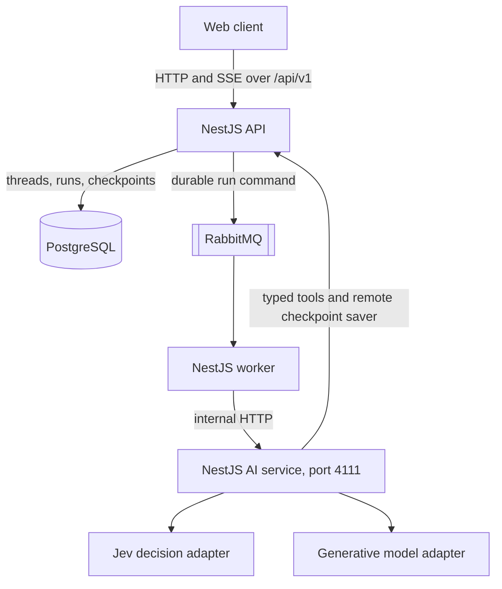
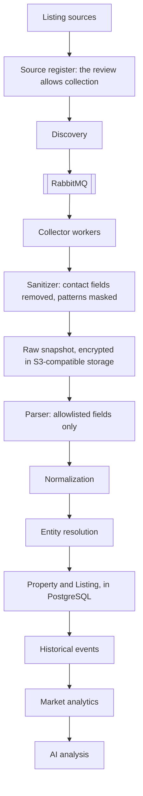
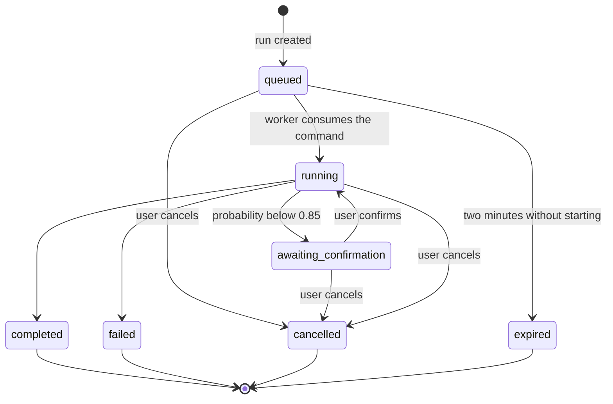

# Architecture: Real Estate Intelligence

> Companion to `spec-real-estate-intelligence.md`, derived by `bmad-spec` from the product brief,
> the AI orchestration plan and the owner's decisions. Accepted ADRs under `specs/adrs/` are
> normative: where this file and an ADR disagree, the ADR wins.

## Decision records

| ADR  | Decides                                                                                         | Binds                          |
| ---- | ----------------------------------------------------------------------------------------------- | ------------------------------ |
| 0003 | `pg` driver, no ORM, versioned SQL migrations, extensions enabled by the migration needing them | All persistence                |
| 0004 | Vitest as the single runner, hand-written doubles, when integration and e2e tests start         | All tests, CAP-17              |
| 0005 | OpenTelemetry with explicit instrumentations, preloaded bootstrap, native NestJS logger         | Every process, CAP-18          |
| 0006 | React 19, Vite 8, TypeScript 5.9 pin; no Tailwind, router or data-fetching library yet          | CAP-19, CAP-20                 |
| 0007 | NestJS 12 for API, worker and AI; LangChain and LangGraph replace Mastra; isolation boundary    | CAP-10 to CAP-18, CAP-25       |
| 0008 | Typed intent routing with Jev, heuristic fallback, 0.85 gate, taxonomy                          | CAP-11, CAP-12, CAP-17         |
| 0009 | Resilience policies for AI providers, Zero Data Retention                                       | CAP-15                         |
| 0010 | Durable runs on RabbitMQ, remote checkpoints in PostgreSQL, SSE, thread capability              | CAP-13, CAP-14, CAP-16, CAP-18 |

ADR 0002 is superseded by ADR 0007. ADR 0001 sets the record itself: an accepted ADR is never
edited, only superseded.

### Decisions awaiting an ADR

The owner took these decisions after the ADRs above; each needs its ADR before code.

| Decision                                                                                                        | Relation         | Affects              |
| --------------------------------------------------------------------------------------------------------------- | ---------------- | -------------------- |
| RabbitMQ is the only broker and also carries collection and parsing jobs; local ports 5672 and 15672            | Extends ADR 0010 | CAP-1, CAP-13        |
| Zero Data Retention on every route; the primary model goes through the gateway until the direct route proves it | Extends ADR 0009 | CAP-10, CAP-15       |
| Field allowlist, sanitized and encrypted raw snapshots, 30-day expiry, suppression list                         | New              | CAP-2, CAP-3, CAP-28 |
| Tile provider and PostGIS, decided with the V2 Map screen                                                       | New              | CAP-24               |

## Current state

- Foundation only: four applications (`apps/web`, `apps/api`, `apps/worker`, `apps/ai`), four
  packages (`@rei/domain`, `@rei/application`, `@rei/contracts`, `@rei/infrastructure`),
  configuration, telemetry, the PostgreSQL connection, health endpoints and the deterministic rule
  `pricePerSquareMeter` in the `market` module.
- No entities, collectors, comparables, AI tools or business endpoints exist. The other domain
  modules are empty placeholders.
- API and worker run NestJS 11 and `apps/ai` runs Mastra; ADR 0007 moves all three to NestJS 12
  and replaces Mastra with LangChain and LangGraph.
- Compose declares PostgreSQL (PostGIS image, no extension enabled), API, worker, AI and web;
  Valkey and MinIO sit under the `optional` profile and nothing consumes them. There is no broker.
- `apps/web` renders the landing page only (see `ux.md`).

## Process topology

| Process       | Owns                                                                                                                                     | Never holds                                                                 |
| ------------- | ---------------------------------------------------------------------------------------------------------------------------------------- | --------------------------------------------------------------------------- |
| `apps/web`    | Screens, the headless run client, locale formatting                                                                                      | Business rules and calculations                                             |
| `apps/api`    | Public facade: creates and reads runs, validates access, persists threads, runs and checkpoints, publishes progress over SSE             | AI provider SDKs                                                            |
| `apps/worker` | Crawling and asynchronous jobs; consumes durable commands, processes them idempotently, serializes runs per thread, calls the AI service | AI provider SDKs                                                            |
| `apps/ai`     | LangChain, LangGraph, model adapters and typed tools; model credentials and internal tokens of minimal scope                             | `DATABASE_URL`, broker or object-storage credentials, `@rei/infrastructure` |

API and worker are the only holders of broker credentials. Tools reach domain capabilities over
typed HTTP, through `/api/v1` or internal endpoints that are explicitly authorized.

### Public and protected surfaces

| Surface   | Holds                                                                                                                       | Access                                                            |
| --------- | --------------------------------------------------------------------------------------------------------------------------- | ----------------------------------------------------------------- |
| Public    | Place overview, search, property, listing, market, comparables, map, natural-language runs within quota, the privacy notice | No authentication; a thread is reached with its opaque capability |
| Protected | Operations, entity-resolution review, alert rules, followed places and properties                                           | An authenticated, authorized user                                 |

Protected operations are built behind the authorization boundary and stay unexposed until
authentication and authorization run. Nothing stands in for them meanwhile: no operator token,
configuration switch or browser-held ownership. The ownership model already reserves a
security-principal identifier for that integration.

## Modules, ports and adapters

Dependency direction: `@rei/api` and `@rei/worker` → `@rei/application` → `@rei/domain`.
`@rei/domain` depends on no framework or SDK.

Business modules, each with an explicit responsibility and low coupling: `properties`, `listings`,
`locations`, `collectors`, `snapshots`, `market`, `comparables`, `analytics`, `search`, `agents`,
`alerts`, `audit`.

| Port                                      | Adapters behind it                                                               |
| ----------------------------------------- | -------------------------------------------------------------------------------- |
| `ObjectStorage`                           | MinIO, R2, any S3-compatible store                                               |
| `ListingSource`                           | One per source: the synthetic dataset, an open-data file, a reviewed site or API |
| `LanguageModel`                           | OpenAI, Anthropic, Gemini, Ollama, any compatible API                            |
| Decision model, embedding model, reranker | External APIs or local models, swapped without touching business rules           |

Vendor DTOs are converted to canonical models before they enter the domain.

## Ingestion pipeline

- Crawling, parsing, enrichment, embeddings, deduplication, snapshot generation and trend analysis
  run in workers, with retries, idempotency, bounded concurrency, rate limiting and dead-letter
  handling where needed. Their jobs travel on RabbitMQ.
- The pair of source and identifier at the source is unique, so ingestion is idempotent (ADR 0003).
- Provenance of a value: `value`, `source`, `collectedAt`, `sourceUrl`.
- Listing events: `ListingCreated`, `ListingPriceChanged`, `ListingDescriptionChanged`,
  `ListingRemoved`, `ListingReappeared`. A removal is only `ListingRemoved`; it is never read as a
  sale.
- An entity-resolution match stores `SamePropertyProbability` and its reasons, for example similar
  coordinates, identical area, identical bedrooms, similar description, overlapping images. In the
  MVP the reasons come from rules only.
- A property's asking price is the lowest among its active listings; place metrics count each
  property once at that price.
- Alerts are evaluated after each collection run, by fixed rules.

Match thresholds, versioned configuration recalibrated against the labelled synthetic dataset:

| Probability          | Outcome                          |
| -------------------- | -------------------------------- |
| 0.90 or more         | Merged automatically             |
| From 0.50 up to 0.90 | Kept separate, queued for review |
| Below 0.50           | Kept separate, not queued        |

### Privacy and sources

The owner, a natural person, is the controller as a small-size processing agent, on the legal basis
of legitimate interest. These rules are an engineering reading of the LGPD, not a legal opinion.

Stored from a real listing, a closed allowlist:

- property type, asking price, area, bedrooms, bathrooms, parking spaces and features;
- the location as the source publishes it, without unit or complement;
- dates, the listing source and the source URL;
- the advertiser type (private or agency) and the agency name, which belongs to a legal entity;
- the description, after phone numbers, e-mail addresses, CPF numbers and links are masked.

Never stored: the name, phone, e-mail or individual CRECI number of a natural person, and
photographs.

Snapshots and removal:

- A raw snapshot of a real source is sanitized before it is stored (contact fields removed, the
  same patterns masked in text), encrypted at rest and deleted 30 days after collection.
  Reprocessing works inside that window; afterwards the normalized data keeps the snapshot hash.
- Snapshots of the synthetic dataset hold no personal data and are kept.
- A removal request deletes the stored data and snapshots of a listing and adds it to a suppression
  list that collection consults, so a later run does not restore it.

Before the first real collection:

- a public privacy notice in Brazilian Portuguese and English, with the contact e-mail;
- the removal routine and its suppression list;
- a record of processing operations and a legitimate-interest assessment, kept in the repository;
- the source register, holding per source the access policy and the date its terms were reviewed.

A source is enabled only after its terms of use, robots policy and licence were reviewed and allow
automated collection; `listing-sources.md` holds the candidates and each outcome. A collector never
works around a login wall, a CAPTCHA, a block or a rate limit. The synthetic dataset stays live as
a labelled source beside any real one.

### Conceptual model

Candidate entities, not a schema:

| Area        | Entities                                     |
| ----------- | -------------------------------------------- |
| Tenancy     | `Workspace`, `User`                          |
| Property    | `Property`, `PropertyFeature`, `Amenity`     |
| Listing     | `Listing`, `ListingSnapshot`, `ListingEvent` |
| Place       | `Location`, `Neighborhood`                   |
| Collection  | `Source`, `Collector`, `CollectionRun`       |
| Comparables | `ComparableSet`, `ComparableProperty`        |
| Market      | `MarketMetric`, `MarketSnapshot`             |
| Outputs     | `Analysis`, `Alert`, `AgentRun`              |

The privacy decisions add a source-register entry and a suppression entry; their names are left to
the stories.

### Where a model may be used

Interpreting descriptions, normalizing features, identifying amenities, assisting entity
resolution, opportunity analysis, explanations, natural-language queries, trend queries and region
summaries. Each probabilistic use needs an evaluation; the brief names intent classification,
property classification, entity resolution, amenity extraction, opportunity analysis and
natural-language responses. An attribute a model read from text is stored with its prompt version
and its source sentence. Retrieval-augmented generation and `pgvector` stay optional: no capability
requires vector search yet.

In the MVP no model takes part in ingestion: entity resolution is rule-based and listing attributes
come from the structured fields of the source. Model-interpreted attributes (CAP-30) and
model-assisted match evidence (CAP-31) arrive in V2, each with its evaluation dataset. A merge
stays decided by the deterministic thresholds, and a model reads a description only in its stored,
masked form.

## Natural-language runs

### Run flow

1. The client sends a query to the API with an idempotency key.
2. The API creates the run as `queued` and publishes a durable command to RabbitMQ.
3. The worker consumes the command, applies serial exclusion per thread and calls the AI service.
4. LangGraph restores the checkpoint, runs the decision node and chooses between clarification, a
   typed tool or an unsupported-intent response.
5. Tools query the API; no tool reaches a database or infrastructure directly.
6. The AI service sends state updates to the remote service that persists the checkpoint.
7. The API publishes progress events over SSE and persists the terminal state.
8. A redelivery reuses the idempotency key and never creates a second logical execution.

### Public run states

Transitions come from the plan's run flow, ADR 0010 and the artboards. Names and schemas are
finalized in the story specs; the distinction between waiting for the user, failure and completion
is mandatory.

### First vertical flow

`price_per_square_meter`: natural-language request, typed intent decision, extraction and
validation of price and area in code, call to the deterministic backend capability, explanation of
the returned result. Jev decides the route, the generative model may explain, and neither
recalculates the value.

| Intent                   | First increment | Outcome                                             |
| ------------------------ | --------------- | --------------------------------------------------- |
| `price_per_square_meter` | Executable      | Deterministic tool result, then a model explanation |
| `listing_search`         | Recognized      | Typed unavailable result                            |
| `property_history`       | Recognized      | Typed unavailable result                            |
| `region_statistics`      | Recognized      | Typed unavailable result                            |
| `comparables`            | Recognized      | Typed unavailable result                            |
| `unsupported`            | Recognized      | Unsupported-intent response                         |

Adding an intent to the taxonomy does not make it executable; a typed backend capability must
exist first. No outcome may rest on knowledge the model improvised.

### Typed decision

The application owns a vendor-independent decision port. Its result carries at least:

- the chosen intent and the probability of the chosen alternative;
- the identifier and version of the decider;
- a degradation flag;
- latency and cost when available;
- the reason for a fallback or failure, sanitized for observability.

Rules:

- The primary adapter calls `typesafe-ai/jev` through the native Vercel AI Gateway API with atomic
  questions and closed alternatives; the response is validated before it enters graph state.
- A missing intent, an unknown alternative or an invalid payload is an adapter failure.
- At 0.85 or above the intent may proceed. Below it the graph enters `awaiting_confirmation` and
  asks for clarification or explicit confirmation, which may authorize the proposed intent without
  another Jev call.
- When Jev is unavailable a deterministic heuristic classifies the recognizable cases and marks the
  result degraded. The degraded flag neither lowers the gate nor adds a second review rule.
- Numbers, dates, money normalization, unit validation and calculations stay in code. The state
  sent to a model is minimal, with sensitive data removed where applicable.

### Generative models

| Role      | Model                             | Route                                                                                              |
| --------- | --------------------------------- | -------------------------------------------------------------------------------------------------- |
| Primary   | Claude Haiku 5.5                  | Vercel AI Gateway with Zero Data Retention; the direct provider route only once it proves the same |
| Secondary | `deepseek/deepseek-v4-flash-0731` | Vercel AI Gateway                                                                                  |

- Selection and fallback sit behind an application port.
- Every route that receives user text requires verified Zero Data Retention. The gateway receives
  `zeroDataRetention: true`; missing support, or missing evidence that the policy was applied,
  blocks the call.
- Initial limits: 16,000 characters of user input and 1,000 generated tokens.
- Portuguese and English are accepted. BRL is the default currency with no implicit conversion.
- The model asserts only deterministic results a tool returned in that run.
- Model identifiers are versioned operational configuration: a story may change one while keeping
  the primary and secondary roles, tool capability and the privacy requirements.

### Resilience

HTTP clients for Jev and the models make a single attempt. Every repetition belongs to
`@nestjs/resilience` policies, composed from the outside in:

| Order | Policy          | Role                                                                               |
| ----- | --------------- | ---------------------------------------------------------------------------------- |
| 1     | Fallback        | Jev degrades to the heuristic; the primary model degrades to the secondary         |
| 2     | Bulkhead        | Caps simultaneous calls, protecting the worker and the providers                   |
| 3     | Circuit breaker | Counts one outcome per logical operation and rejects fast while a provider is down |
| 4     | Retry           | Transient failures only, inside the remaining deadline                             |
| 5     | Rate limiter    | Every real attempt consumes capacity                                               |
| 6     | Timeout         | Bounds each HTTP attempt and propagates cancellation                               |

Failure matrix:

| Failure                                            | Treatment                                                      |
| -------------------------------------------------- | -------------------------------------------------------------- |
| `429`, `5xx`, timeout, network                     | Transient: retried                                             |
| `400 invalid_request`                              | Not retried; not counted by the breaker as a transient failure |
| Authentication, authorization                      | No automatic retry                                             |
| Exhausted quota, when identifiable                 | Opens the circuit immediately                                  |
| Zero Data Retention violated or impossible to meet | Fails closed; no fallback to a less private route              |
| Caller cancellation                                | Propagated; never becomes a heuristic or generative answer     |

- `Retry-After` is honoured only when it fits the remaining deadline; other retries use bounded
  exponential backoff with jitter.
- Limits, windows and timings are calibrated in the stories with fake-clock tests and are never
  scattered as constants in adapters.
- Typed policy events feed OpenTelemetry and metrics for retry, timeout, bulkhead rejection,
  breaker transitions, rate limiting and fallback, without prompts, responses or credentials.

### Durability, checkpoints and streaming

| Concern              | Rule                                                                                                            |
| -------------------- | --------------------------------------------------------------------------------------------------------------- |
| Broker               | RabbitMQ, on a dedicated vhost of the VPS's shared instance; it also carries collection and parsing jobs        |
| Delivery             | Persistent messages, publisher confirms, explicit acknowledgements, idempotent redelivery, dead-letter handling |
| Capacity             | At most three pending runs per thread; a queued run expires after two minutes                                   |
| Ordering             | Serial within a thread, parallel across threads                                                                 |
| Source of truth      | PostgreSQL for threads, runs and checkpoints                                                                    |
| Checkpointer         | A LangGraph remote saver that calls the API; `apps/ai` never instantiates a pool                                |
| Interrupt and resume | The run pauses for confirmation and resumes on the same `thread_id`                                             |
| Retention            | 30 days, keeping the terminal state and up to eight relevant turns                                              |
| Progress             | SSE with versioned events, resumable, ending in a terminal event                                                |

### Security and identity

- The public demo applies quotas before it accepts a run and does not rely on the provider's rate
  limit alone: 20 questions per visitor per calendar day in America/Sao_Paulo, plus a global daily
  cap on runs. Both numbers are configuration, and an over-quota response says when the quota
  reopens.
- In the MVP an opaque capability protects each thread; the API validates it before exposing
  history, confirmation, cancellation or SSE.
- The ownership model reserves a security-principal identifier for a later Keycloak integration.
- The AI service receives only model credentials and internal tokens of minimal scope.
- Tools are allowlisted; the model creates no URL, SQL or operation name.
- The brief also asks for authentication, authorization, workspace isolation, rate limiting, input
  validation, secret management and audit logs. Protected operations wait for the first two (see
  Public and protected surfaces); when authentication lands is an open question of the spec.

### Observability

One trace context follows the HTTP request, the AMQP publish, the consume, the run, each LangGraph
node, the Jev decision, the tool and the generative call, and checkpoint operations.

Recorded, without sensitive content:

- queue time and total run duration;
- current node and graph transitions;
- intent, confidence, confirmation decision and degradation;
- provider and model, tokens, cost and latency;
- retries, timeouts, breaker, bulkhead and fallback;
- tool calls and categorical results.

Never recorded: prompts, full responses, keys, credentials, connection strings, whole payloads.

The brief extends the same instrumentation to requests, jobs, collectors, crawl duration, parsing
errors and enrichment failures.

### Evaluation pack

Default tests use fakes and local datasets. The first pack covers:

- taxonomy classification in Portuguese and English;
- cases below, above and exactly at the 0.85 gate;
- Jev failure and invalid payload;
- Jev compared with the heuristic, measuring confidence, accuracy, latency and cost;
- selection and validation of the price-per-square-meter tool;
- fidelity of the explanation to the deterministic result;
- the failure matrix of the resilience composition;
- pause, checkpoint, confirmation, resume and idempotency.

The live Jev probe is opt-in, requires `AI_GATEWAY_API_KEY`, is never part of `pnpm test` or
default CI, and reports accuracy, latency and cost without storing the key or sensitive text.

### Contracts each increment must fix

- create, read and cancel a run;
- confirm a pending intent;
- open and resume an SSE stream;
- publish and consume the durable command;
- save, load and expire checkpoints;
- call the deterministic price-per-square-meter tool;
- represent decision, degradation, failure and execution metadata.

## Infrastructure and ports

| Service    | Port        | Note                                                                                |
| ---------- | ----------- | ----------------------------------------------------------------------------------- |
| Web        | 3200        |                                                                                     |
| API        | 8200        | Public contract under `/api/v1`                                                     |
| AI service | 4111        | Internal; called by the worker                                                      |
| PostgreSQL | 5434        | PostGIS and `vector` available in the image, enabled per migration                  |
| Valkey     | 6380        | `optional` profile; no consumer; not the broker                                     |
| MinIO      | 9100, 9101  | `optional` profile                                                                  |
| RabbitMQ   | 5672, 15672 | AMQP and management; the only broker; the workspace port table still has to list it |

The Compose project is `real-estate-intelligence` and publishes only its assigned ports.
Development servers bind to `0.0.0.0`.

## Delivery

The plan authorizes no single-pass implementation: each increment is sliced, specified,
implemented and validated separately. Before the first code story the instruction files are
corrected: `/workspace/CLAUDE.md` and the repository `AGENTS.md` and `CLAUDE.md` move to NestJS 12
and LangGraph, `/workspace/CLAUDE.md` stops placing product specifications under `specs/`, and the
workspace port table gains RabbitMQ.

The owner targets the whole MVP together, so no group waits behind another by preference. Stories
are ordered by dependency: the data foundation before market reading, a screen after the capability
it shows, the natural-language increment independently. RabbitMQ arrives with whichever of
ingestion or the natural-language increment lands first. Protected operations wait for
authentication.

Planned sequence of the natural-language increment, each story ending in observable behaviour with
tests proportional to its risk:

1. Upgrade NestJS and remove Mastra without changing business behaviour.
2. Create the NestJS foundation of `apps/ai` with LangGraph and the integration ports.
3. Implement Jev, the heuristic, the confidence gate and confirmation.
4. Expose `pricePerSquareMeter` as a typed HTTP capability and a graph tool.
5. Implement runs, threads and the remote saver on PostgreSQL.
6. Introduce RabbitMQ, idempotency, per-thread serialization and dead-letter handling.
7. Expose the public contracts, SSE and the headless client.
8. Complete telemetry, security, quotas, datasets and probes.
9. Expand one intent at a time, each only once its deterministic capability exists.

Exit criteria of that increment:

- No Mastra dependency remains at runtime or in the build; the Mastra-only bundle script and its
  internal `npm` call are gone.
- The graph pauses and resumes an ambiguous query without losing state.
- Jev or the heuristic produces a typed, auditable decision under the same gate.
- The price per square meter is calculated by the domain and only explained by the model.
- A redelivered message duplicates neither the run nor the tool effect.
- Provider failures are bounded, observable and never violate the privacy policy.
- The AI service runs without PostgreSQL, RabbitMQ or object-storage credentials.
- The client follows the run over SSE to a terminal state.
- Offline tests pass without network and the live probe stays explicitly optional.

Later phases: V2 brings comparables, market analytics, the map with PostGIS and a tile provider,
execution of the remaining intents by the graph, model-interpreted attributes, model-assisted
entity resolution and the dark theme. Alerts, Operations and Review wait for authentication.

## Capability to architecture map

Module names follow the brief's conceptual list and are indicative.

| Capability     | Lives in                                                                             | Governed by                                               |
| -------------- | ------------------------------------------------------------------------------------ | --------------------------------------------------------- |
| CAP-1          | Collectors in `apps/worker`; `ListingSource` adapters; source register               | Ingestion pipeline; Privacy and sources; ADR 0003         |
| CAP-2          | `snapshots`; `ObjectStorage` port; sanitizer                                         | Ingestion pipeline; Privacy and sources                   |
| CAP-3          | `properties`, `listings`, `locations`                                                | Conceptual model; field allowlist; ADR 0003               |
| CAP-4          | Entity resolution in the domain and application packages                             | Ingestion pipeline; match thresholds                      |
| CAP-5          | `listings`, `snapshots`                                                              | Listing events                                            |
| CAP-6          | `search`; `/api/v1`                                                                  | ADR 0003                                                  |
| CAP-7, CAP-8   | `properties`, `listings`; `/api/v1`                                                  | Conceptual model; asking-price rule                       |
| CAP-9          | `market`, `analytics`                                                                | Deterministic rules                                       |
| CAP-10         | Graph in `apps/ai`; typed tool over `/api/v1`; `pricePerSquareMeter`                 | ADR 0007, ADR 0008                                        |
| CAP-11, CAP-12 | Decision port and adapters in `apps/ai`                                              | ADR 0008                                                  |
| CAP-13         | `apps/api` persistence, `apps/worker` delivery, RabbitMQ, PostgreSQL                 | ADR 0010                                                  |
| CAP-14         | Run endpoints and SSE in `apps/api`; headless web client                             | ADR 0010                                                  |
| CAP-15         | Resilience policies around the adapters in `apps/ai`                                 | ADR 0009; Zero Data Retention on every route              |
| CAP-16         | `apps/api`                                                                           | ADR 0010; demo quota                                      |
| CAP-17         | Datasets and tests beside the adapters                                               | ADR 0004, ADR 0008                                        |
| CAP-18         | OpenTelemetry bootstrap of each process                                              | ADR 0005, ADR 0010                                        |
| CAP-19, CAP-20 | `apps/web`                                                                           | ADR 0006; `ux.md`; `apps/web/DESIGN.md`                   |
| CAP-21         | `comparables`                                                                        | Deterministic rules; PostGIS when distance needs it       |
| CAP-22         | `market`, `analytics`                                                                | Deterministic rules                                       |
| CAP-23         | `alerts`                                                                             | Fixed rules, after each collection run; protected surface |
| CAP-24         | Map in `apps/web`; `locations`                                                       | Tile provider and PostGIS, by ADR at V2                   |
| CAP-25         | One typed tool per intent in `apps/ai`                                               | ADR 0008                                                  |
| CAP-26         | `collectors`; `/api/v1`; `apps/web`                                                  | Ingestion pipeline; protected surface                     |
| CAP-27         | Entity-resolution review; `audit`                                                    | Audit log; match thresholds; protected surface            |
| CAP-28         | Privacy notice in `apps/web`; removal and suppression in `listings` and `collectors` | Privacy and sources                                       |
| CAP-29         | Tokens and styles in `apps/web`                                                      | `apps/web/DESIGN.md`; `ux.md`                             |
| CAP-30         | Extraction through `apps/ai`; interpreted attributes in `listings`                   | Where a model may be used                                 |
| CAP-31         | Entity resolution; embedding model port                                              | Where a model may be used; match thresholds               |

## Deferred to the stories

- Final names of endpoints, exchanges, routing keys, tables and fields, within the ADR invariants.
- Final names and schemas of the public run states and SSE events.
- Limits, windows and timings of the resilience policies.
- How an anonymous demo visitor is identified, and the value of the global daily cap.
- What "No, rephrase" does to a paused run, and whether a run awaiting confirmation expires.
- The masking patterns and their tests, the encryption mechanism of the object store and the shape
  of the suppression list.
